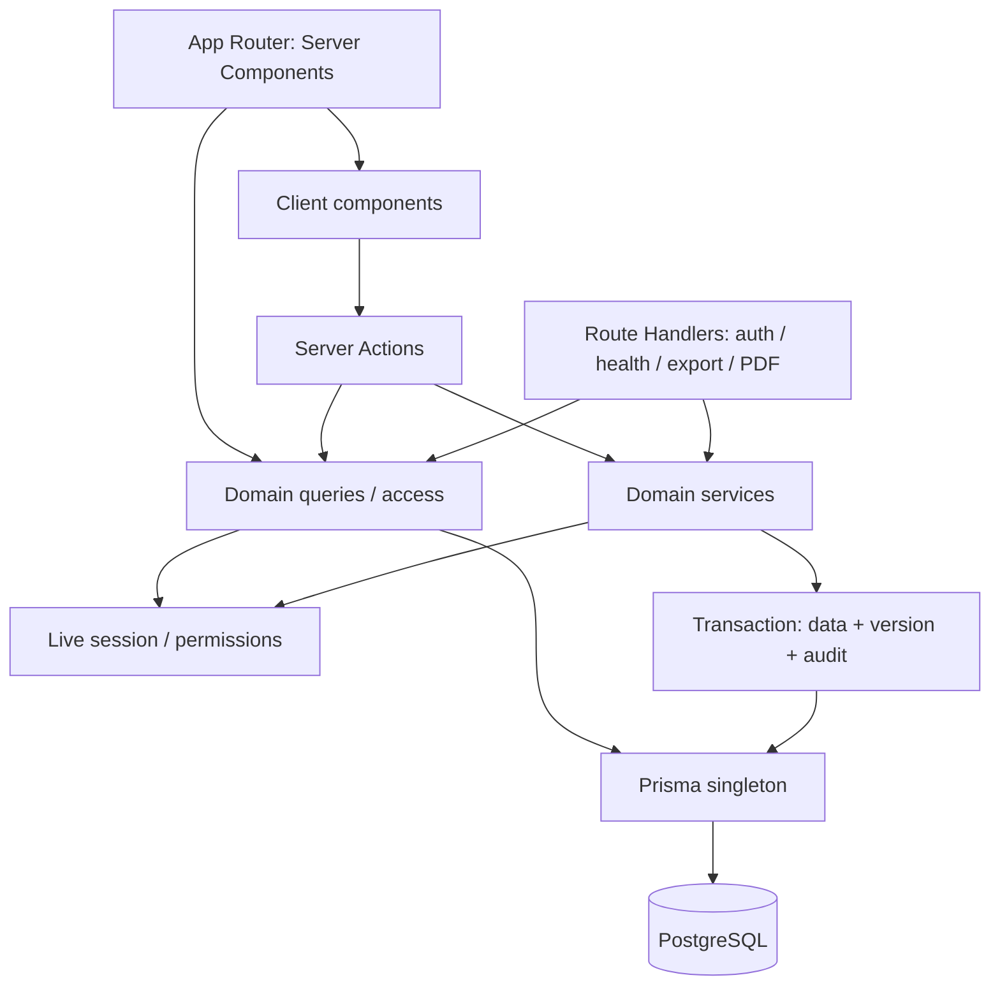
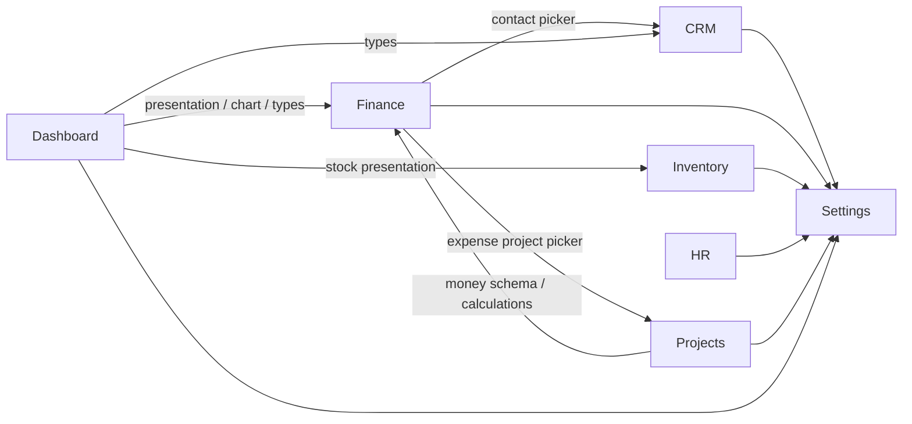
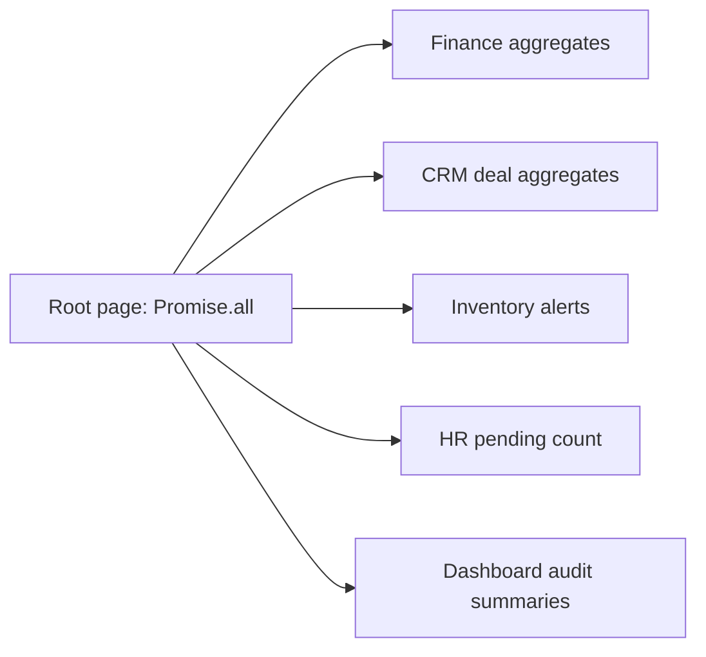

# Архитектура Evo ERP

Финальная архитектурная редакция TASK-028, актуализирована в TASK-030, 20.10.2026. Документ описывает реализацию после TASK-027; статусы приёмки — в [roadmap](roadmap.md) и [verification](verification.md), финальные доказательства — в [CHECKPOINT-05](CHECKPOINT-05.md). Публикация Git подтверждается отдельно от технической приёмки. При изменении кода обновлять соответствующий ADR и документацию модуля. Обязательные правила — [INSTRUCTIONS.md](../INSTRUCTIONS.md), история решений по задачам — `docs/TASK-*.md`, референсы — [references.md](references.md).

## 1. Архитектурная модель

Evo ERP — модульный монолит Next.js App Router с одной PostgreSQL. Server Components получают начальные данные; клиентские компоненты отвечают за формы, таблицы, DnD и графики. Бизнес-операции выполняются на сервере через Server Actions и доменные сервисы. Route Handlers нужны для Auth.js, health, CSV и PDF, а не как второй полный CRUD API.



Серверные `access`, `queries` и `service` отделены от клиентских модулей через `server-only`. UI не импортирует Prisma, секреты или серверную сессию. Server Actions принимают DTO без доверенных `workspaceId`/role; tenant и права определяются заново на сервере.

### Границы модулей

| Модуль | Основные модели | Маршруты и ответственность |
| --- | --- | --- |
| CRM | Contact, Deal, Activity | `/crm/contacts`, `/crm/contacts/[id]`, `/crm/pipeline`: контакты, этапы сделок, активности |
| Finance | Invoice, InvoiceSequence, InvoiceItem, Payment, Expense | `/finance`, `/finance/dashboard`, `/finance/payments`, `/finance/expenses`, `/finance/reports`: счета/PDF, поступления, расходы, аналитика |
| Inventory | Product, Warehouse, StockItem, StockMovement | `/inventory`, `/inventory/warehouses`, `/inventory/dashboard`, карточка товара: каталог, остатки и ledger |
| HR | Employee, EmployeeDocumentLink, LeaveAllowance, Leave | `/hr`, `/hr/org-chart`, `/hr/leaves`, профиль сотрудника: каталог, подчинённость, отпуска |
| Projects | Project, Task | `/projects`, `/projects/overview`: задачи Kanban/List, прогресс, бюджет, команда, timeline |
| Settings | Settings, Membership, WorkspaceInvitation; чтение AuditLog | `/settings`, `/settings/users`, `/settings/audit`, `/invite/[token]`: конфигурация и доступ |
| Dashboard | Собственных бизнес-моделей нет | `/`: композиция KPI и summaries существующих модулей |
| Shared kernel | Workspace, User, Session, AuditLog; общие контракты | `src/lib`, `src/types`, `src/hooks`, `src/components/ui`, `src/i18n` |

Сохраняется переходный DocType-слой `Document`/`DocumentPayment`: `document-service → repository`, metadata registry и явный demo-store. Например, `/crm` ещё использует прежнюю таблицу документов, тогда как контакты и pipeline нормализованы. Этот слой не является универсальным хранилищем новых модулей; его значения и результаты нельзя смешивать с нормализованными KPI. См. [database.md](modules/database.md) и [lib/document-service.ts](../src/lib/document-service.ts).

### Граф зависимостей модулей

Стрелка ниже означает фактический импорт `@/modules/...`, включая клиентские форматтеры и DTO. Это не граф внешних сервисов или только связей БД.



Settings предоставляет отдельно серверные configuration queries и клиентский ConfigurationProvider. Finance ↔ Projects — существующая взаимная зависимость вспомогательных схем/форм, не вызов двух мутаций по кругу. При развитии её следует уменьшать выделением общих money-контрактов в shared kernel; такое выделение ещё не выполнено. Общий DnD-hook уже находится в `src/hooks`, Projects не импортирует CRM Kanban-компонент.

Композиция главной страницы — отдельный уровень:



Связи данных не равны импортам: Invoice требует Contact и может ссылаться на Deal/Project; InvoiceItem — на Product; Expense — на Project; Project — на Contact и Membership руководителя; Task — на Project и Membership исполнителя; Employee — на Membership и другого Employee. Все межмодульные ссылки проверяются в текущем workspace. Источник — [schema.prisma](../prisma/schema.prisma).

## 2. Architecture Decision Records

Все десять ADR приняты; дата этой редакции — 20.10.2026. Раздел «Альтернативы» объясняет выбор, не утверждая, что альтернативная реализация была построена или измерена.

### ADR-001 — Стек

**Контекст.** Нужен ERP с серверными правами, интерактивными рабочими таблицами и единой TypeScript-моделью.

**Решение.** Next.js 15 / React 19 / TypeScript 5, PostgreSQL и Prisma 6; Tailwind 3, Shadcn/Radix primitives; RHF + Zod; NextAuth v5; next-intl; TanStack Table; DnD Kit; Recharts; `@react-pdf/renderer`. Версии зафиксированы [package-lock.json](../package-lock.json), а не диапазонами из внешних примеров. На дату редакции: Next 15.5.28, React 19.1.0, Prisma 6.19.3, NextAuth 5.0.0-beta.32. Контейнер — Node 24 Debian slim, PostgreSQL 16 Alpine. Faker используется только явным seed, не runtime fallback.

**Альтернативы.** Отдельный SPA/API увеличил бы число контрактов и развёртываний; внешний ERP framework определял бы модель и UI вместо модульного шаблона.

**Последствия.** Один deploy и репозиторий, клиентские islands для интерактивности. TypeScript включает strict/noUncheckedIndexedAccess/exactOptionalPropertyTypes, `any` запрещён. Изменения major-версий требуют отдельной проверки; Auth.js beta не считать стабильной v5. См. [package.json](../package.json), [Dockerfile](../Dockerfile), [docker-compose.yml](../docker-compose.yml).

### ADR-002 — Модульная структура

**Контекст.** Домены имеют разные workflow, но общие tenant, права, UI и аудит.

**Решение.** Базовый модуль: `src/modules/<domain>/{types,schema,actions,queries,service}.ts` и `components/`. Дополнительные `access`, `serializers`, `*-service`, `*-schema`, `presentation` допустимы для отдельных сценариев. Чтения и мутации разделены; доменные сервисы работают с Prisma напрямую. Shared — только повторно используемые контракты, primitives и hooks, а не копии доменной логики.

**Альтернативы.** Глобальные каталоги всех services/components затрудняют владение; универсальный DocType CRUD недостаточен для ledger, invoice workflow и отпусков.

**Последствия.** Модули могут иметь явные зависимости, указанные выше; микросервисы, очереди и универсальный event bus не введены. Settings/Dashboard являются модулями приложения, хотя тип `Domain` исторически содержит только пять бизнес-доменов. Источники: [src/modules](../src/modules), [shared.ts](../src/types/shared.ts), [lib/modules.ts](../src/lib/modules.ts).

### ADR-003 — Result<T>

**Контекст.** UI должен различать ошибки валидации, прав, конкурентного изменения и PostgreSQL без анализа исключений и строк.

**Решение.** Бизнес-фасады возвращают discriminated union:

```ts
type Result<T, E = AppError> =
  | { ok: true; data: T }
  | { ok: false; error: E };

type AppError = {
  code: ErrorCode;
  message: string;
  meta?: Record<string, unknown>;
};
```

`ErrorCode`: `VALIDATION`, `UNAUTHORIZED`, `FORBIDDEN`, `NOT_FOUND`, `CONFLICT`, `STORAGE`, `CONFIGURATION`. Используются `ok`, `err`, `createError`, `isNotFound`; `success`/`failure` сохранены как совместимые aliases. Ответ содержит сериализуемые DTO: Date → ISO/date-only, Decimal/BigInt → десятичная строка. В meta не передаются stack, SQL, секреты или Prisma-объекты.

**Альтернативы.** Исключения для ожидаемых исходов делают UI-ветвления неявными; nullable result теряет причину отказа.

**Последствия.** Нужно явно проверять `result.ok`. JSX и чистые helpers сохраняют естественные типы; Credentials `authorize` возвращает User/null по Auth.js, HTTP handler — Response с сериализованным Result. Внутренние исключения БД перехватываются серверной границей. Возврат `err(...)` из Prisma transaction callback сам по себе **не откатывает** уже сделанные записи: проверки выполняются до записи, а неожиданный сбой записи должен прервать транзакцию. Источники: [shared.ts](../src/types/shared.ts), [errors.ts](../src/lib/errors.ts).

### ADR-004 — Server Actions

**Контекст.** Формы и DnD должны использовать одну бизнес-операцию с повторной серверной авторизацией.

**Решение.** `actions.ts` с `"use server"` — тонкий публичный фасад: вызов access/query/service, локализация Result и revalidation затронутых путей после успешного commit. Имена `getXxx/createXxx/updateXxx/deleteXxx`; UI callbacks — `handleXxx`. Read Server Components вызывают серверные queries. Экспорт/PDF остаются Route Handlers с собственными live guard и проверкой canExport.

**Альтернативы.** Полный REST CRUD поверх тех же сервисов дублировал бы transport; клиентская валидация без серверной не защищает данные.

**Последствия.** Server Action доступна независимо от видимости кнопки: схема, tenant и role обязательны на сервере. Клиент скрывает недоступные действия лишь для UX. После конфликта UI перечитывает актуальные данные; сбой refresh после commit не означает откат и не должен вызывать слепое повторение платежа. Источники: [CRM actions](../src/modules/crm/actions.ts), [Finance actions](../src/modules/finance/actions.ts), [PDF route](../src/app/api/finance/invoices/[id]/pdf/route.ts).

### ADR-005 — Prisma и PostgreSQL

**Контекст.** Финансы, остатки, ссылки между доменами и аудит требуют транзакций и ограничений в БД.

**Решение.** Один server-only Prisma singleton; в development используется globalThis для HMR, в production — экземпляр модуля. Схема содержит 27 моделей и 15 enum. Tenant-модели имеют workspaceId, индексы и составные ключи/FK `(id, workspaceId)`; ссылки на участников используют Membership. Миграции хранят и SQL CHECK/trigger, которые Prisma schema целиком не выражает. Нет DB RLS: каждое чтение и запись обязаны ограничивать workspace на уровне приложения.

Изменяемые сущности проверяют ожидаемую version, обновление увеличивает её. Создание начинается с version 1; отсутствие Settings/StockItem/LeaveAllowance имеет специальные сценарии version 0. Создание неизменяемого ledger не требует версии несуществующей записи, но проверяет версии затронутых остатков. Business write и audit выполняются в одной транзакции.

Finance/Inventory/HR/Projects используют Serializable wrappers с максимум тремя попытками **только при P2034**, означающей откат. CRM и Settings не имеют такого автоматического retry; Settings дополнительно перепроверяет активного actor/role внутри транзакции. Нельзя приписывать всем модулям одинаковую политику повторов или in-transaction recheck прав. Для согласованных списков/агрегатов Projects использует RepeatableRead. Независимые запросы запускаются Promise.all, но это не общий snapshot.

Для сложных агрегатов — tagged `$queryRaw` с параметрами; поля сортировки/SQL identifiers выбираются из whitelist. Shared literal search учитывает кириллицу и экранирует wildcard. UI не передаёт произвольный Prisma where/orderBy. Пагинация выполняется сервером, DTO не содержат Prisma instances.

**Альтернативы.** JSON-only документы не обеспечивают нужные связи; прямые SQL-конкатенации небезопасны; SQLite не заменяет PostgreSQL-инварианты.

**Последствия.** Миграции обязательны; ошибка БД возвращает STORAGE, не демоданные. Наличие composite FK защищает ссылки, но не заменяет tenant-фильтры чтений. Источники: [db.ts](../src/lib/db.ts), [schema](../prisma/schema.prisma), [migrations](../prisma/migrations), [Projects mutation](../src/modules/projects/task-service.ts).

### ADR-006 — Shadcn и CSS variables

**Контекст.** Таблицам, формам и модальным сценариям нужны единые темы, доступность и mobile поведение.

**Решение.** Переиспользуемые primitives находятся в `src/components/ui`; Radix управляет focus/keyboard у соответствующих Dialog/Sheet. Семантические Tailwind-классы ссылаются на HSL CSS variables из globals.css. Палитра не задаётся внутри компонентов. Тема `.dark` управляется общим ThemeProvider. Шрифты Geist Sans/Mono; Sonner — общие уведомления. Entrance animations и prefers-reduced-motion задаются общими motion-правилами.

**Альтернативы.** Цвета и виджеты по отдельности в модулях расходятся при смене темы; полная UI-библиотека навязала бы другой визуальный контракт.

**Последствия.** Новый UI использует существующие Button/Table/Sheet/EmptyState и токены. Ни hex, ни прямые цветовые Tailwind utilities не подменяют tokens. Sidebar становится Sheet при ширине <768px; таблицы/Kanban прокручиваются внутри области. `loading.tsx`, error boundaries и информативные empty states — часть маршрута. Источники: [globals.css](../src/app/globals.css), [UI](../src/components/ui), [TASK-026](TASK-026.md).

### ADR-007 — TanStack Table

**Контекст.** Рабочие реестры требуют типизированных колонок, server pagination, сортировки и bulk selection.

**Решение.** Headless TanStack Table управляет моделью таблицы; DOM/стили остаются в UI проекта. Server query владеет поиском, фильтрами, сортировкой и общим count. Контракты `PaginatedResponse`, `SortConfig`, `FilterConfig` находятся в shared.ts. Пустой результат имеет totalPages 0; page — с единицы. Клиент не сортирует только текущую страницу, выдавая её за полный набор.

**Альтернативы.** Самописная таблица дублирует selection/sorting; клиентская загрузка всего реестра не подходит растущим данным.

**Последствия.** Паттерны CRM переиспользованы в Projects и других реестрах. CRM selection между страницами хранит ID/version, сервер заново проверяет права и записи; bulk ограничен, экспорт защищён отдельно. Нельзя считать все legacy-таблицы уже переведёнными на этот контракт. Источники: [CRM components](../src/modules/crm/components), [Projects components](../src/modules/projects/components), [TASK-007](TASK-007.md).

### ADR-008 — DnD Kit

**Контекст.** CRM pipeline и Projects Kanban имеют одинаковый механический drag/drop, но разные workflow.

**Решение.** DnD Kit core/sortable и общий [use-kanban-dnd.ts](../src/hooks/use-kanban-dnd.ts); модуль задаёт колонки, карточку и action перехода. Optimistic UI хранит предыдущий snapshot, передаёт expected version, при отказе восстанавливается и перечитывает сервер. Мышь/касание/клавиатура используют общие sensors.

**Альтернативы.** Отдельный hook для каждой доски нарушает DRY; собственный drag engine усложняет доступность и pointer handling.

**Последствия.** DnD не обходит status schema, RBAC и audit. Projects сохраняет статус, а не пользовательский rank: после refresh применяется серверный порядок updatedAt/id. Серверные страницы колонок не означают загрузку всех задач. Источники: [TASK-008](TASK-008.md), [TASK-021](TASK-021.md).

### ADR-009 — NextAuth v5

**Контекст.** Нужны парольный вход и отзыв доступа при изменении Membership без доверия устаревшему JWT role.

**Решение.** NextAuth v5 Credentials, JWT strategy, зашифрованная HttpOnly/SameSite=Lax cookie; Secure на HTTPS. AUTH_SECRET (совместимо NEXTAUTH_SECRET) обязателен, URL — AUTH_URL/NEXTAUTH_URL. Пароли — salted scrypt с constant-time сравнением. Session в PostgreSQL — реестр отзыва с tokenHash, а не PrismaAdapter database session strategy; сырой cookie/token в БД не хранится. Срок серверной сессии фиксирован: 12 часов.

На проверке сессии перечитываются реестр/срок, Workspace, User.isActive, Membership.isActive и текущая role. Login выбирает последнее использованное активное Membership. SUPER_ADMIN также ограничен им. UI AuthSessionProvider/usePermissions закрывает права при loading/authError и обновляет сессию периодически/при focus, но не заменяет server guard.

**Альтернативы.** Только JWT claims оставляют старые права до expiry; отдельная auth-система увеличивает объём собственного security-кода.

**Последствия.** STORAGE при отказе БД закрывает доступ; деморежим — отдельный явный opt-in, нормализованные домены его не используют. Invitations: одноразовый 7-дневный token, SHA-256 hash в БД, проверка полномочий пригласившего при принятии. UI выдаёт ссылку; email transport не подключён. Нет MFA, password reset, rate limiter и полноценного workspace switch. Источники: [auth.ts](../src/lib/auth.ts), [auth-service.ts](../src/lib/auth-service.ts), [Settings service](../src/modules/settings/service.ts), [TASK-024](TASK-024.md).

### ADR-010 — Audit Log

**Контекст.** Изменение данных должно иметь tenant-scoped след, совпадающий с фактическим commit.

**Решение.** Доменные audit helpers записывают AuditLog тем же Prisma transaction client, что бизнес-операцию. Поля: workspaceId, actorId/снимок actor, domain, action, entityType/entityId, title, before/after, createdAt; requestId опционален. Action — created/updated/deleted/payment. Prisma AuditLog отображается в таблицу `AuditEvent`; normalized Payment — в `invoice_payments`.

Audit хранит сериализуемые снимки без password, token, cookie и секретов; у конфигурации сохраняется признак наличия logo, не PNG. Административный reader дополнительно ограничивает глубину/размер и исключает ключи password/secret/token/hash. Это защита чтения, не основание записывать чувствительные данные. Системные заголовки локализуются по entityType, пользовательские названия сохраняются.

**Альтернативы.** Клиентский event после ответа теряется при закрытии страницы; post-commit отдельная запись может отсутствовать. Централизованный middleware не знает смысл invoice/payment snapshots.

**Последствия.** Audit failure откатывает бизнес-запись. Полный viewer ADMIN+ показывает последние 100 событий; Dashboard — последние 8 безопасных summaries без before/after; legacy snapshot ограничивает UI-историю 50 событиями, панель уведомлений — 12. Notification toggles фильтруют панель, не запись аудита. PostgreSQL хранит историю дольше UI-выборок. AuditLog append-only по соглашению приложения: DB trigger неизменяемости введён для StockMovement, не для всего аудита. requestId не даёт универсальную идемпотентность, outbox/exactly-once не реализованы. Источники: [schema](../prisma/schema.prisma), [Settings queries](../src/modules/settings/queries.ts), [Dashboard queries](../src/modules/dashboard/queries.ts), [repository](../src/lib/repository.ts).

## 3. RBAC и tenant isolation

Единственный общий источник ролей/флагов — [permissions.ts](../src/lib/permissions.ts). Ни роль из формы, ни скрытая кнопка не являются авторизацией. Unknown/missing role и permission отклоняются. Все разрешения ниже действуют **только в активном workspace**.

### Базовая матрица

| Role | canWrite | canDelete | canExport | canManageUsers | canViewAll |
| --- | --- | --- | --- | --- | --- |
| SUPER_ADMIN | Да | Да | Да | Да | Да |
| ADMIN | Да | Да | Да | Да | Да |
| MANAGER | Да | Да | Да | Нет | Да |
| AGENT | Да | Нет | Нет | Нет | Да |
| READONLY | Нет | Нет | Нет | Нет | Да |

canWrite — helper, остальные четыре флага — PERMISSIONS. canViewAll не означает доступ к другой компании или к административному Audit viewer. Ролевой field-level ACL на HR/зарплату сейчас отсутствует.

### Матрица операций

«Да» разрешает проверку операции, но не отменяет её workflow/ссылки/version. Порядок ролей — от наиболее привилегированной к READONLY.

| Операция | SUPER_ADMIN | ADMIN | MANAGER | AGENT | READONLY |
| --- | --- | --- | --- | --- | --- |
| Читать рабочие CRM/Finance/Inventory/HR/Projects данные | Да | Да | Да | Да | Да |
| Создавать/обновлять обычные доменные записи | Да | Да | Да | Да | Нет |
| Удалять CRM/Finance/Inventory/Projects записи | Да | Да | Да | Нет | Нет |
| Удалять Employee и ссылки на его документы | Да | Да | Нет | Нет | Нет |
| Создать Payment | Да | Да | Да | Да | Нет |
| Создать StockMovement | Да | Да | Да | Да | Нет |
| Изменить/удалить существующий StockMovement | Нет | Нет | Нет | Нет | Нет |
| Создать Leave | Да | Да | Да | Да | Нет |
| Approve/Reject Leave, задать годовой allowance, видеть pending approvals | Да | Да | Да | Нет | Нет |
| Экспорт CRM/P&L CSV, Invoice PDF | Да | Да | Да | Нет | Нет |
| Читать настройки компании, менять свой язык/тему | Да | Да | Да | Да | Да |
| Менять company/logo/currency/timezone/date format/notifications | Да | Да | Нет | Нет | Нет |
| Users, invitations, membership role/status, полный Audit viewer | Да | Да | Нет | Нет | Нет |
| Назначать/управлять ролью SUPER_ADMIN | Да | Нет | Нет | Нет | Нет |

Дополнительные ограничения:

- Invoice редактируется и удаляется только как неоплаченный DRAFT; Payment отклоняет переплату и повтор reference. Общего API изменения/удаления Payment нет. Статус PAID не назначается вручную.
- StockMovement создаёт ledger и balance атомарно; update/delete запрещены также DB trigger, даже при прямом SQL.
- Leave допускает PENDING → APPROVED/REJECTED; terminal request не имеет edit/delete workflow. Роль MANAGER согласует заявки workspace, Employee.managerId не задаёт отдельное дерево прав.
- Удаление связанных Contact/Product/Warehouse/Employee и других сущностей может быть запрещено ссылками/историей независимо от роли.
- Settings запрещает смену собственных role/access и потерю последнего активного администратора; деактивация Membership отзывает его сессии в workspace. Неактивный глобальный User не восстанавливается этой формой.
- Dashboard Activity и in-app summaries доступны читателям, но не раскрывают before/after административного аудита. Недоступный HR pending KPI обозначается как недоступный, а не 0.

## 4. Доменные инварианты и вычисления

### Деньги и Finance

Все новые бизнес-записи и настройки используют **EUR**. Нормализованные деньги — Decimal(20,0), целые евроценты; quantity — Decimal(20,3), taxRate — Decimal(5,2) процентов. DTO содержит строки, вычисления используют decimal/BigInt helpers. Произвольные денежные значения нельзя приводить к JS Number; для графиков допускается ограниченная проекция с точными текстовыми данными рядом.

Для Invoice сначала округляется каждая `qty × unitPrice` до евроцента (half-up), затем `subtotal = Σ(lineTotal)`, `taxAmount = round(subtotal × taxRate / 100)`, `total = subtotal + taxAmount`. Номер `INV-YYYY-NNNN` выдаёт InvoiceSequence по workspace/году и не переиспользует номер удалённого draft. Workflow: DRAFT → SENT, затем PAID по поступлениям или OVERDUE по due date; отменить в CANCELLED можно только неоплаченный допустимый статус. Частичная оплата сохраняет непогашенный остаток; overdue определяется календарём workspace.

Finance Dashboard и главный Dashboard считают Revenue по поступлениям, Paid MTD — по receivedAt. **P&L имеет другую базу:** полные суммы счетов с налогом, полностью погашенных на asOf, по дате последнего учтённого платежа; частичные оплаты исключены. Expenses отбираются по Expense.date; Net Profit = Revenue − Expenses. Оба плеча P&L читаются одним SQL statement. Это управленческий отчёт, не бухгалтерский ledger или accrual accounting. Источники: [calculations.ts](../src/modules/finance/calculations.ts), [reports.ts](../src/modules/finance/reports.ts), [Finance docs](modules/finance.md).

Существующие RUB-записи переведены одноразовой миграцией `20261020000200` по согласованному курсу 1 EUR = 93 RUB с округлением и пересчётом invoice aggregates. Исторические audit snapshots/неизменяемые stock ledger entries не переписываются. Общий formatter способен форматировать ISO currency, но runtime бизнес-схемы не дают мультивалютность или FX-конвертацию. Legacy DocumentPayment имеет Int-лимиты; это не формат новых нормализованных Payment.

### Inventory

Остаток товара — сумма StockItem по складам. `in_stock`: qty > minStock; `low_stock`: 0 < qty ≤ minStock; `out_of_stock`: qty = 0. Sidebar считает low + zero, low-stock banner — именно low. KPI каталога использует активные товары. Стоимость — количество × цена продукта, не FIFO/средневзвешенная оценка.

Входные операции IN/OUT/ADJUSTMENT/TRANSFER создают immutable StockMovement. Transfer сохраняет пару TRANSFER_OUT/TRANSFER_IN с общей связью и нулевым итоговым изменением товара. StockItem — транзакционно обновляемый balance cache, версии обоих затронутых складских остатков проверяются. Отрицательные остатки отклоняются; резервы и партии не реализованы. См. [Inventory docs](modules/inventory.md), [TASK-016](TASK-016.md).

### HR и Projects

Employee.managerId — self-relation с защитой циклов, связь с User опциональна. EmployeeDocumentLink — именованные ссылки на документы, receipt расходов — ссылка на чек; оба используют HTTP(S), не файловое хранилище. Leave days считаются включительно через date-fns без суббот/воскресений; праздников и half-days нет. Пересечение PENDING/APPROVED одного сотрудника запрещено. Годовой allowance задаётся вручную; отсутствие означает «не задан», 0 — явный лимит. Balance = allowance − APPROVED ANNUAL weekdays в границах года, включая будущие дни; PENDING отдельно. Нет accrual/carryover и блокировки согласования по отрицательному balance. См. [HR docs](modules/hr.md).

Projects Kanban: TODO/IN_PROGRESS/IN_REVIEW/DONE; исторический CANCELLED доступен в List. DONE устанавливает completedAt, повторное открытие очищает его. Progress = DONE / все задачи проекта, включая CANCELLED. Budget usage = сумма связанных Expense в EUR за всё время; Invoice revenue не является расходом. Team = distinct manager + task assignees, не список всех участников workspace. Timeline — CSS Grid с ограниченным диапазоном 1–93 дня, без Gantt-библиотеки. См. [Projects docs](modules/projects.md).

## 5. Конфигурация, локализация и чтение данных

Settings — singleton **на workspace**, не одна строка на всё приложение. При отсутствии строки `getAppConfiguration` возвращает валидные defaults с version 0 без записи. Ошибка PostgreSQL/невалидная конфигурация возвращает STORAGE. Save ADMIN+ атомарно меняет Settings, Workspace.name и audit с expected version. React.cache объединяет чтения в рамках server request; tenant configuration не помещается в общий изменяемый process cache.

ConfigurationProvider передаёт подтверждённый snapshot клиенту. `useAppFormat`, `configuredDate/configuredTimestamp` применяют IANA timezone и date format компании. DATE остаётся календарной датой; timestamp переводится в выбранную timezone. Новый workspace по умолчанию использует Europe/Moscow, но рабочие периоды Finance/HR/Dashboard/overview учитывают Settings. **Известное исключение:** Task dueDate пока преобразуется task-service в конец дня `+03:00`; смена timezone не меняет этот алгоритм.

Logo — inline PNG с проверкой signature, размером до 256 KB и стороной до 1024 px; сервер не загружает произвольный logo URL. Currency фиксирована EUR. Notification flags created/updated/deleted/payment управляют in-app панелью и не отключают audit, HR pending или stock badges. Источники: [config-queries](../src/modules/settings/config-queries.ts), [config-service](../src/modules/settings/config-service.ts), [ConfigurationProvider](../src/modules/settings/configuration-provider.tsx), [Settings docs](modules/settings.md).

next-intl: English по умолчанию, русский через Settings; locale хранится в cookie `evo_locale`, без URL-prefix. Неизвестная cookie → en. Каталоги локализуют интерфейс, server errors, статусы, PDF/CSV; enum и пользовательские тексты в БД не переводятся. Интерполяция не превращает имена/notes в ключи перевода. См. [LOCALIZATION.md](LOCALIZATION.md), [src/i18n](../src/i18n).

Главный Dashboard читает пять независимых источников через Promise.all после live session и валидации currency; configuration получают использующие её queries. Route force-dynamic/no-store предотвращает повторное использование чужого snapshot; это не единая DB-транзакция. Каждый источник показывает ошибку вместо ложного нуля, ошибка auth закрывает страницу. Projects использует RepeatableRead там, где список/агрегаты должны совпасть; HR profile запускает независимые чтения параллельно без обещания общего snapshot. См. [root page](../src/app/(dashboard)/page.tsx), [Dashboard docs](modules/dashboard.md).

Cmd+K открывает lazy-loaded cmdk palette, Cmd+N использует контекстный зарегистрированный NewRecordAction, Esc закрывает Sheet/Dialog. Palette ищет маршруты/действия и ограниченный legacy snapshot, не все нормализованные таблицы. URL `create=1` обрабатывается однократно с сохранением остальных filters/hash; используются существующие формы. Loading/error/empty states, mobile и reduced-motion проверены в [TASK-026](TASK-026.md).

## 6. Процедура добавления нового модуля

1. **Определить контракт.** Описать сущности, workflow, деньги/даты, связи, права и границы в `docs/modules/<domain>.md`. Сверить [INSTRUCTIONS](../INSTRUCTIONS.md), shared types/primitives/hooks и актуальные ADR. Выбрать нормализованные модели; использовать legacy Document только для осознанной совместимости.
2. **Добавить схему и миграцию.** Для tenant-сущностей — workspaceId, составные unique/FK, Membership для actor/owner, version/createdAt/updatedAt где применимо и индексы под workspace/filter/order. В SQL migration добавить необходимые CHECK/trigger, не ограничиваться Prisma validate. Не применять миграции к произвольной удалённой БД автоматически.
3. **Создать границу модуля.** Ввести `types.ts` (wire DTO), `schema.ts` (Zod), `access.ts`, `queries.ts`, `service.ts`, `actions.ts`, `components/`. Серверные файлы пометить server-only, actions — use server. Дополнительные файлы выделять по сценарию, как Projects task/overview. У публичных функций — JSDoc, у UI handlers — handleXxx.
4. **Настроить авторизацию.** Получать workspaceId/userId/role только из live session. Не считать новый Domain автоматически разрешённым. Тип `Domain` сейчас связан с `Record<Domain,...>` legacy registries: если расширять его, проверить `lib/modules.ts`, schemas/document-service/repository, permissions и audit presentation. Не создавать фиктивный RecordData ради компиляции: либо реализовать legacy adapter осознанно, либо выделить отдельный нормализованный access contract (Settings уже имеет собственный). Actor/related ID проверять в том же tenant.
5. **Реализовать запросы.** Whitelist фильтров/сортировки, безопасные параметры SQL, server pagination/лимиты, сериализация Date/Decimal. Независимые чтения — Promise.all; согласованный набор — statement/транзакционный snapshot. Не кэшировать tenant result глобально; явно определить поведение ошибки и empty state.
6. **Реализовать мутации.** Проверить input/id/version/workflow/ссылки до записи, выполнить write + version increment + audit в одной транзакции. Для зависимости от конкурентного состояния выбрать подходящий isolation и retry только гарантированно откатившейся операции. Не возвращать Result-ошибку после частичной записи в надежде на rollback; не повторять внешние side effects внутри retry callback. Определить delete protection и идемпотентность отдельно.
7. **Подключить UI.** Начальные данные в Server Component, client islands для интерактивности. Переиспользовать UI, TanStack и DnD-hook; кнопки согласовать с серверным RBAC. Добавить en/ru сообщения, company formatters, entrance/reduced-motion, доступность, mobile, loading/error/empty states и обработку conflict/network error.
8. **Зарегистрировать навигацию и интеграции.** Добавить маршруты, Sidebar/Header/command palette и NewRecordAction при наличии create. Проверить [workspace-commands](../src/components/layout/workspace-commands.ts), [new-record-provider](../src/components/layout/new-record-provider.tsx) и legacy metadata registry отдельно. Для audit добавить безопасные title/entity links/domain mapping; проверить notification summaries. Интеграцию KPI подключать явно, не читать legacy документы вместо новых моделей.
9. **Проверить и документировать.** В обычной задаче — build и визуальная проверка изменённого UI; typecheck/Prisma validate по области. Новые тестовые файлы создаются только в CHECKPOINT. Проверить tenant/RBAC, stale version, rollback audit, обе локали/темы/mobile; на checkpoint использовать изолированную реальную PostgreSQL. Обновить этот документ, доменные docs/roadmap/verification; конфликты законов фиксировать в contradictions.md. Commit/push — по разрешению и правилам текущей задачи.

## 7. Эксплуатация и границы реализации

Docker: build → standalone app, отдельный tools stage для Prisma, non-root production process; PostgreSQL 16 health → migration job → app. Sample seed запускается явно через profile, не при каждом старте. Локальные данные/env/secrets исключены из build context; секреты поступают в runtime через environment, Dockerfile не задаёт AUTH_SECRET. `/login` — liveness приложения; `/api/health` проверяет БД с авторизацией. Новый PG16 volume не выполняет downgrade старого PG17 volume. Команды и подтверждённые проверки — [TASK-027](TASK-027.md), настройки — [.env.example](../.env.example).

`prisma/seed.ts` поддерживает изолированный Faker sample и bootstrap только администратора. Sample: admin, 20 contacts, 10 deals, 5 invoices, 15 products, 3 warehouses, 8 employees, 3 projects с tasks; advisory lock/transaction/marker делают повторный запуск no-op, сохраняющий пользовательские изменения. Конфликт email не захватывает чужой аккаунт. Production bootstrap требует явных данных администратора; Vercel build не создаёт sample. Demo-store разрешён только отдельным opt-in и никогда не заменяет отказ PostgreSQL. См. [seed.ts](../prisma/seed.ts), [TASK-027](TASK-027.md).

Vercel production build применяет миграции перед Next build; Preview не мигрирует и не seed-ит общую БД. Это политика текущего [vercel-build.mjs](../scripts/vercel-build.mjs), а не гарантия изолированных БД окружений или zero-downtime migrations. Детали — [DEPLOYMENT.md](DEPLOYMENT.md).

Остаются явные ограничения: legacy DocType coexistence; Finance/Projects helper coupling; отсутствие field-level HR ACL, email transport, полноценного workspace switch, login rate limiting/MFA/reset; документы-ссылки без file storage; нет бухгалтерских проводок/refunds/FX, резервов/партий, автоматического leave accrual; нет универсального outbox, workflow engine и idempotency API. Архитектура не объявляет эти возможности реализованными. Согласования требований собраны в [журнале противоречий](contradictions.md). Финальный Developer Guide и техническая приёмка описаны в [TASK-030](TASK-030.md) и [CHECKPOINT-05](CHECKPOINT-05.md).
