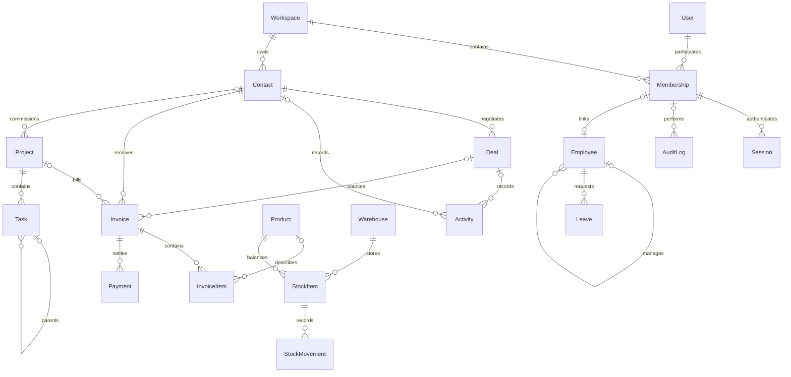

# База данных ERP — TASK-002

Источник схемы: `prisma/schema.prisma`. Провайдер — PostgreSQL, Prisma 6.19.3. Схема содержит 21 модель и 13 Prisma enums: все модели TASK-002, Workspace/Membership и два совместимых legacy-типа.

## Связи модулей

Каждая бизнес-запись принадлежит одному Workspace. Ссылки на сущности используют составной FK `(entityId, workspaceId) → (id, workspaceId)`. Поэтому существующий ID записи из чужого пространства нельзя присоединить к своей записи. Назначения ответственным используют `(userId, workspaceId) → Membership`, а не ссылку только на глобальный User.

FK не заменяют авторизацию чтения: запросы должны брать workspace из серверной сессии и включать его в `where`. RLS этой задачей не вводится.

## AUTH и workspace

| Модель | Назначение и связи |
| --- | --- |
| `User` | Глобальная учётная запись: уникальный email, имя, nullable avatar, UserRole, isActive, passwordHash, timestamps. Один User может участвовать в нескольких пространствах. |
| `Workspace` | Граница tenant. Связан с участниками, сессиями, всеми доменными моделями и legacy-документами. |
| `Membership` | Составной PK `(userId, workspaceId)`, роль в данном пространстве и isActive. Через Membership назначаются владельцы контактов/сделок, исполнители, менеджеры, согласующие и авторы операций. |
| `Session` | TokenHash — PK: SHA-256 случайного registry ID защищённого JWT, userId, workspaceId, фиксированный expiresAt, createdAt. FK одновременно проверяют User, Workspace и Membership. Удаление членства отзывает связанные сессии. |
| `AuditLog` | Actor display snapshot, nullable actorId → Membership, domain/action/title, entityType/entityId, before/after JSON, requestId, createdAt. Удаление связанного участника/пространства ограничено для сохранения истории. |

Авторитетная роль для бизнес-операций — `Membership.role`. `User.role` — глобальное/default-поле, не право обходить workspace. Текущая авторизация дополнительно проверяет `User.isActive` и `Membership.isActive`; выключенный пользователь или участник не получает доступ через ранее выданную сессию. `seed.ts` задаёт ADMIN и User, и Membership при создании нового администратора.

TASK-004 сохраняет passwordHash/scrypt, переводит cookie на Auth.js JWT и использует Session как registry для отзыва и проверки активного Membership. Account/VerificationToken и Prisma Adapter не нужны Credentials/JWT strategy. Старые opaque cookie требуют повторного входа. Миграция `20261018072336_auth_rbac` переименовывает enum VIEWER → READONLY на месте и добавляет SUPER_ADMIN/AGENT, сохраняя строки и defaults.

## CRM

- `Contact`: имя, компания, контакты, адрес, ContactStage, nullable owner → Membership. Имеет сделки, активности, счета и проекты.
- `Deal`: обязательный Contact, nullable owner → Membership, DealStage, value: Decimal, currency, ожидаемая дата закрытия и closedAt. Одна сделка может иметь несколько активностей и счетов.
- `Activity`: ActivityType, subject, nullable Contact/Deal и исполнитель → Membership, описание, dueAt/completedAt. SQL CHECK требует хотя бы Contact или Deal. Если указаны оба, соответствие контакта контакту сделки должен проверять сервис.

## FINANCE

- `Invoice`: уникальный в workspace number, обязательный Contact, nullable Deal/Project/creator, InvoiceStatus, subtotal, taxRate, total, issueDate/dueDate. Налог задаётся процентом 0–100 на весь нетто-subtotal.
- `InvoiceItem`: обязательный Invoice, nullable Product, позиция, snapshot-описание, quantity, unitPrice, total. Уникальная позиция в счёте. Удаление неоплаченного счёта каскадно удаляет его строки; удаление Product, используемого в строках, ограничено.
- `Payment`: обязательный Invoice, положительный amount, PaymentMethod, уникальный в workspace reference, receivedAt, nullable receivedBy → Membership. Наличие платежа блокирует физическое удаление счёта через FK Restrict.

Денежные поля используют `Decimal @db.Decimal(20, 0)` и хранят **целые минимальные денежные единицы**, для RUB — копейки. Это сохраняет правило проекта о копейках и выполняет требование Decimal без перехода на Float. Пример: 123,45 ₽ хранится как `12345`. TaxRate — `Decimal(5,2)` в процентах. Quantity — `Decimal(20,3)`, поэтому поддерживаются дробные объёмы.

Арифметика: `InvoiceItem.total = round(quantity × unitPrice, 0)`, `Invoice.total = round(subtotal × (1 + taxRate / 100), 0)`. SQL CHECK защищает эти равенства. Сумму строк, равенство валют, сумму платежей, запрет переплаты и переходы статусов нужно обеспечивать в транзакции доменного сервиса: межстрочные суммы не выражены CHECK-ограничениями. Округление PostgreSQL numeric до копейки — half away from zero; для положительных денег это half-up.

В HTTP/Server Action DTO передавать Decimal строкой (`toFixed(0)` для денег) или явно ограниченным числом копеек. Не преобразовывать произвольный Decimal(20,0) в JS number: диапазон превышает MAX_SAFE_INTEGER. Prisma/SQL не заменяют Zod-проверку precision/scale на входе; numeric-колонки могут округлять лишние дробные разряды.

## INVENTORY

- `Product`: уникальный SKU в workspace, название, nullable category VARCHAR(100) (TASK-015), единица, costPrice/salePrice, minStock, currency и isActive. Деньги — Decimal(20,0); minStock — Decimal(20,3). Миграция `20261019000200_inventory_product_category` добавляет только category и индекс workspace/category, сохраняя существующие строки.
- `Warehouse`: уникальный code в workspace, название, адрес, isActive.
- `StockItem`: один остаток qty для `(workspaceId, productId, warehouseId)`. Product и Warehouse обязаны принадлежать тому же workspace. Остаток неотрицателен.
- `StockMovement`: относится к StockItem, хранит type, signed quantity, qtyBefore/qtyAfter, nullable creator, transferId/reference. CHECK проверяет `qtyAfter = qtyBefore + quantity`, неотрицательные балансы и знак движения. IN/TRANSFER_IN — плюс, OUT/TRANSFER_OUT — минус, ADJUSTMENT — любая ненулевая дельта.

Перемещение между складами — две записи TRANSFER_OUT/TRANSFER_IN с общим transferId. CHECK требует transferId только для этих типов. Парность, один Product, сохранение общего количества и атомарное обновление двух StockItem должны обеспечиваться сервисом, не одним SQL CHECK.

TASK-016: Serializable movement service реализует атомарные позиции/ledger/audit. Миграция `20261019000300_immutable_stock_ledger` дополнительно создаёт `stock_movement_immutable` (BEFORE UPDATE/DELETE) и deferred `stock_transfer_pair` (AFTER INSERT, проверка transfer pair к commit). Журнал исправляется новыми entries. SQL functions/triggers не представлены Prisma schema и сохраняются миграциями; read-only schema diff не проверяет их бизнес-поведение.

## HR

- `Employee`: внутренний id и отдельный человекочитаемый employeeId, уникальный внутри workspace. HireDate — DATE, EmployeeStatus, отдел/должность/контакты. Nullable userId связывает сотрудника с Membership 1:1 в данном workspace; сотрудник может существовать без входа в систему.
- `managerId` — self-relation Employee в том же workspace. У руководителя есть `reports`. CHECK запрещает назначить самого себя; длинные циклы руководителей проверяет сервис.
- `Leave`: обязательный Employee, LeaveType/LeaveStatus, startDate/endDate, положительное число days с точностью 2 знака, причина, nullable approvedBy → Membership. FK использует внутренний Employee.id, не человекочитаемый employeeId. CHECK запрещает обратный диапазон дат.

Согласование, право согласующего, пересечения отпусков и календарь рабочих дней относятся к последующим сервисам HR. Дни допускают половины/доли, но схема не рассчитывает их автоматически.

## PROJECTS

- `Project`: уникальный code внутри workspace, имя/описание, ProjectStatus, budget: Decimal, currency, nullable Contact/manager и диапазон дат.
- `Task`: обязательный Project, TaskStatus, Priority, позиция, nullable исполнитель → Membership, dueAt/completedAt. Nullable parentId ссылается составным FK `(parentId, projectId, workspaceId)` на Task, поэтому родитель обязательно из того же проекта и workspace. CHECK запрещает прямую ссылку на себя; длинные циклы проверяет сервис.

## Enums

| Enum | Значения |
| --- | --- |
| UserRole | SUPER_ADMIN, ADMIN, MANAGER, AGENT, READONLY |
| ContactStage | LEAD, PROSPECT, CUSTOMER, INACTIVE |
| DealStage | NEW, QUALIFIED, PROPOSAL, NEGOTIATION, WON, LOST |
| ActivityType | CALL, EMAIL, MEETING, NOTE, TASK |
| InvoiceStatus | DRAFT, SENT, PARTIALLY_PAID, PAID, OVERDUE, CANCELLED |
| PaymentMethod | BANK_TRANSFER, CARD, CASH, OTHER |
| MovementType | IN, OUT, TRANSFER_IN, TRANSFER_OUT, ADJUSTMENT |
| EmployeeStatus | ACTIVE, ON_LEAVE, TERMINATED |
| LeaveType | ANNUAL, SICK, UNPAID, PARENTAL, OTHER |
| LeaveStatus | PENDING, APPROVED, REJECTED, CANCELLED |
| ProjectStatus | PLANNING, ACTIVE, ON_HOLD, COMPLETED, CANCELLED |
| TaskStatus | TODO, IN_PROGRESS, IN_REVIEW, DONE, CANCELLED |
| Priority | LOW, MEDIUM, HIGH, URGENT |

## Индексы, удаление и контроль версий

У каждой доменной модели есть candidate key `(id, workspaceId)`, version, createdAt/updatedAt. Номер счёта, SKU, warehouse/project code, employeeId и reference платежа уникальны внутри tenant. Индексы начинаются с workspaceId и покрывают статусы, dueDate, участников, связь с клиентом/проектом и историю StockItem. Дочерняя задача дополнительно имеет candidate key `(id, projectId, workspaceId)`.

Доменные FK преимущественно Restrict: вместо удаления используемых сущностей следует менять isActive/статус. Исключение — строки InvoiceItem при удалении неоплаченного Invoice. Удаление User/Membership отзывает Sessions, но наличие бизнес-ссылок на Membership может блокировать физическое удаление: для отзыва доступа использовать isActive.

Приложение должно изменять доменные записи с проверкой/increment version и создавать AuditLog в той же транзакции. Само поле version не реализует optimistic locking без соответствующего WHERE. AuditLog по назначению append-only, но универсального SQL-триггера запрета UPDATE/DELETE в TASK-002 нет.

CHECK-ограничения находятся в SQL миграции: Prisma 6 не выражает их через schema.prisma. Пересоздавать базу только через db push нельзя — будут потеряны проверки, определённые историей миграций.

## Совместимость и миграция

| Prisma API | Таблица/тип PostgreSQL | Причина |
| --- | --- | --- |
| UserRole | enum `Role` | Сохраняет роли прежних Membership без пересоздания enum. |
| AuditLog | `AuditEvent` | Сохраняет существующую историю и индексы; добавляет структурированные поля аудита. |
| DocumentPayment | `Payment` | Сохраняет старые оплаты JSON-документов, Int-копейки и исходные связи. |
| Payment | `invoice_payments` | Отдельные нормализованные оплаты Invoice; не смешиваются с JSON-документами. |
| Document | `Document` | Переходный DocType-слой текущего работающего интерфейса. |

В TASK-002 текущий UI остаётся на Document/DocumentPayment. Репозиторий переведён на новые имена Prisma delegates (`auditLog`, `documentPayment`); новые Contact/Invoice/Product/... не заполняются автоматически из неоднозначного JSON. Перевод модулей и миграция их данных выполняются отдельными задачами. При выключенном ERP_DEMO_MODE ошибка PostgreSQL остаётся ошибкой, а не подменяется демоданными.

Начальная миграция `202610170001_init` сохраняется. Новая `20261018065839_init_all_modules` добавляет доменные таблицы, новые поля AUTH, индексы, составные FK и CHECK. Содержит транзакцию BEGIN/COMMIT. Таблицы/колонки со старыми данными не удаляются; меняется только FK аудита с Cascade на Restrict.

Команды: `npx prisma generate`, затем `npx prisma migrate dev --name init_all_modules` для разработки. Для уже сохранённых миграций на сервере — `npm run db:migrate`. Не выполнять reset при наличии данных. Результаты фактической проверки фиксируются в `docs/TASK-002.md`.

## CRM сервисы — TASK-006

Нормализованные Contact/Deal/Activity теперь доступны через отдельный CRM Server API (см. [crm.md](crm.md)). FK дополняются сервисными проверками: активные User/Membership ответственного в текущем workspace, соответствие Activity.contactId контакту Activity.dealId. При указании только dealId контакт активности выводится из сделки.

Contact update/delete и Deal stage update включают version в WHERE и увеличивают её при обновлении. Serializable-транзакция объединяет чтение, проверки, мутацию и AuditLog с JSON before/after. Restrict сохраняет контакт, если он используется. Пагинация/группировка читается через RepeatableRead. Денежные суммы поступают в Prisma.Decimal без округления и выходят строками. Новые таблицы/миграции этой задачей не добавляются. Переходные Document-записи не копируются в нормализованные таблицы автоматически.

TASK-009: Contact.tags — PostgreSQL TEXT[] с default [] и CHECK на non-null array, отсутствие null-элементов и максимум 20 значений. Миграция 20261018084403_contact_detail_tags добавляет только поле/constraint внутри BEGIN/COMMIT, существующие контакты получают []. Zod дополнительно требует trimmed непустые строки до 32 символов и отсутствие повторов без учёта регистра. Изменение tags использует version и тот же атомарный AuditLog, что остальные поля Contact. Лента detail читает Activity/Deal только после tenant-scoped проверки родителя; count и страницы согласованы RepeatableRead.

## TASK-011 — Invoice aggregate и нумератор

Миграция `20261018094007_invoice_crud_pdf` добавляет nullable Invoice.customerSnapshot (Json) и issuerName, не меняя существующие денежные единицы или FK. Snapshot name/company/email/address сохраняется при создании/правке черновика; выданный счёт не изменяется вместе с Contact. Старые строки без snapshot читаются через связь.

InvoiceSequence имеет составной PK (workspaceId, year), value Int, FK Workspace с Restrict и SQL CHECK year 1–9999/value 0–999999999. Миграция заполняет счётчики максимальным suffix существующих INV-YYYY-NNNN (4–9 цифр), не перенумеровывает документы. Создание sequence/increment, Invoice, InvoiceItem и AuditLog выполняется атомарно в Serializable. Удаление draft не удаляет sequence.

Invoice → InvoiceItem/Payment сохраняет составные tenant FK. Вложенный create строк наследует workspaceId от родителя Prisma; строки заменяются целиком только в DRAFT под версией родительского Invoice. Payment, новая версия/статус и AuditLog атомарны. PAID получается из суммы платежей; OVERDUE вычисляется при чтении. PARTIALLY_PAID остаётся в enum для совместимости, новый сервис его не присваивает. Подробная политика округления и переходов — [finance.md](finance.md).

## TASK-013 — Expense

Additive migration `20261019000100_finance_expenses` создаёт ExpenseCategory (OFFICE/SOFTWARE/TRAVEL/MARKETING/EQUIPMENT/RENT/UTILITIES/OTHER) и Expense: title VARCHAR(200), amount Decimal(20,0) в целых копейках, currency CHAR(3), category enum, DATE date, nullable receipt VARCHAR(2048)/notes, version и audit timestamps. Expense.workspaceId → Workspace Restrict; (createdById, workspaceId) → Membership(userId, workspaceId) Restrict. Уникальный (id, workspaceId), индексы workspace/date/createdAt/id, workspace/category/date и workspace/creator.

CHECK в SQL, не заменяемые Prisma schema: title не пуст, amount/version >0, RUB/USD/EUR, date 0001–9999, notes до 10000, nullable canonical http(s) receipt без credentials/пробелов. Серверная Zod-проверка URL строже и нормализует URL. Каждый update/delete сверяет version; Expense и AuditLog Expense before/after записываются атомарно. Данные существующих таблиц не переносятся и не изменяются миграцией.

## Employee profile — TASK-020

Additive migration `20261019000400_employee_profile`: EmployeeDocumentLink (workspace/employee, title VARCHAR(200), url VARCHAR(2048), notes VARCHAR(2000), version, timestamps) и LeaveAllowance (workspace/employee, year, days Decimal(6,2), version, timestamps). Composite FK к Employee(id,workspaceId) и FK к Workspace — RESTRICT. Allowance уникален по workspace/employee/year; CHECK year 1900…9999, целые days 0…9999, version >0. Document CHECK nonempty title, http(s) URL и version >0; более строгая безопасная URL-валидация выполняется сервером и перед рендером. Document list index workspace/employee/createdAt/id, unique id/workspace для обеих моделей. Данные Employee/Leave не переписываются. Allowance хранит явную кадровую настройку, без правового default или автоматического начисления.

## Projects tasks — TASK-021

Migration `20261019000500_task_review_status`: ALTER TYPE TaskStatus RENAME VALUE REVIEW TO IN_REVIEW, сохраняет id/version/relations всех прежних задач. Четыре рабочих статуса и CANCELLED для read-only истории. Модели/поля/FK Task и Project не изменены.

## Project budget usage — TASK-022

Migration `20261019000600_project_expenses`: nullable Expense.projectId TEXT, index (workspaceId,projectId,currency), composite FK (projectId,workspaceId) → Project(id,workspaceId), ON DELETE RESTRICT/ON UPDATE CASCADE. Старые расходы не привязываются автоматически, новые модели не создаются. Project.budget остаётся Decimal(20,0) в копейках; usage derived из расходов той же валюты, другие валюты отдельно.
